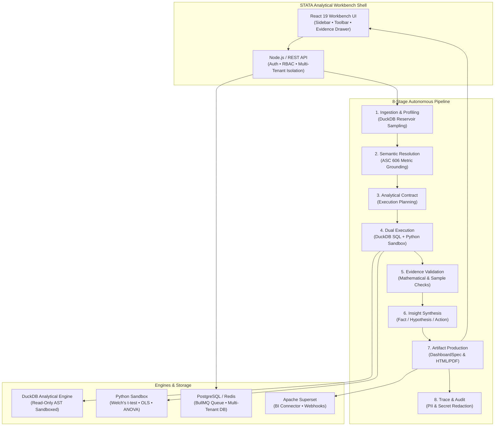

# STATA — Analytical Workbench

> **Autonomous Data Science & Statistical Intelligence Platform**  
> *Built by Navaneeth*

[](https://duckdb.org)
[](https://mastra.ai)
[](https://react.dev)
[](https://echarts.apache.org)
[](https://scipy.org)
[](LICENSE)

---

## 1. Executive Summary

**STATA** is a production-quality, professional analytical workbench designed for data scientists, quantitative analysts, and executive stakeholders. It bridges the gap between raw data storage and verified business intelligence by combining the **Mastra AI framework**, an embedded in-process **DuckDB analytical engine**, and an isolated **Python statistical sandbox**.

Unlike generic AI chatbots that hallucinate numbers or infer metrics solely from column headers, **STATA** operates under strict data governance standards:
- **Zero Number Hallucinations**: Every metric, distribution, and visualization is computed directly on authorized tabular data (CSV / Parquet) via AST-sandboxed DuckDB queries.
- **Enterprise Semantic Layer**: Maps questions to certified financial and operational metrics conforming to accounting standards (e.g. ASC 606 revenue recognition).
- **Evidence-First Integrity**: Distinguishes empirical facts from exploratory hypotheses, flags small sample sizes ($n < 30$), and strictly enforces the rule that correlation does not imply causation.
- **Publication-Ready Deliverables**: Automatically synthesizes interactive Apache ECharts dashboards, print-ready HTML/PDF executive reports, and scheduled webhook/BI dispatches.

---

## 2. Platform Architecture



---

## 3. Core Capabilities & Dedicated Workbench Views

### 📊 Overview & Strategic Discoveries
- Answers three primary questions upfront:
  1. *What dataset is being analyzed?* (Row counts, column counts, completeness score, sample size $n$).
  2. *What has STATA discovered?* (Prioritized agent findings with plain-language explanations, empirical evidence, and limitations).
  3. *What should the user investigate next?* (Contextual deep-dive exploration pathways).
- **Slide-Out Evidence Inspector**: Accessible from every finding to inspect the confirmed executed DuckDB SQL, sample sizes, and causation guardrails.

### 🛡️ Data Quality & Observability
- Modeled after enterprise data observability monitors.
- 5 Health dimensions: Completeness Score, Evaluated Rules, Null Counts, Duplicate Rows, and Outlier Alerts.
- Column-level profiling cards with data type badges (`# Numeric`, `A Text`, `Logical`, `📅 Date`), mini distribution histograms, null percentages, min/max/mean/median/stdDev, and anomaly flags.

### 📈 Statistical Distributions
- Univariate histograms and Interquartile Range (IQR $1.5\times$) outlier boundaries.
- Identifies distribution skewness, central tendencies (Median vs. Mean), and kurtosis.

### 🔄 Relationships & Bivariate Associations
- Pairwise Pearson correlation matrices ($r$) with sample size ($n$) and degrees of freedom ($df$).
- Scatter plot visualizers with residual distributions.
- **Mandatory Causation Guardrail**: Enforces clear disclosures that correlation does not demonstrate or imply causation.

### 📅 Trends & Time-Series Trajectories
- Trajectory tracking across verified timestamp dimensions with daily bucketing.
- Automated volatility markers flagging records exceeding $\pm 2.0\sigma$ from rolling run-rates.

### 📑 High-Density Data Explorer
- Paginated, sortable, and filterable tabular data view with column type headers (`#`, `A`, `📅`).
- Interactive **Row Inspector Drawer** for field-by-field inspection of individual records.

### 🔔 Schedules & Enterprise BI Integrations
- Database-backed cron scheduler supporting recurring (`0 9 * * 1`) and one-time executions.
- Timezone and daylight-saving time correction via `cron-parser`.
- HMAC-SHA256 authenticated webhooks and Apache Superset REST synchronization.

---

## 4. Technology Stack

| Layer | Technologies | Role & Purpose |
| :--- | :--- | :--- |
| **Agent Framework** | **Mastra Core (`@mastra/core`)** | Agent definition, multi-step workflows, tool routing, memory, and observability. |
| **Frontend UI** | **React 19, TypeScript, Vite** | High-performance analytical workbench with responsive layouts. |
| **Visual Charts** | **Apache ECharts (`echarts-for-react`)** | Fluid, accessible visualizations (bars, donuts, lines, scatter plots). |
| **Analytical Query Engine** | **DuckDB (`duckdb` v1.4.4)** | Embedded vectorized SQL database operating directly on CSV and Parquet. |
| **Statistical Engine** | **Python (Scipy, NumPy, Statsmodels)** | Process-isolated worker executing Welch's t-test, ANOVA, and OLS regression. |
| **Backend API** | **Node.js, REST, TSX** | Secure backend server with RBAC, session auth, and dataset management. |
| **Job Queue** | **BullMQ & Redis** | Distributed background job execution with stage progression and retries. |
| **Persistent Storage** | **PostgreSQL** | Multi-tenant relational storage for users, datasets, and schedules. |
| **Report Generation** | **Puppeteer Core (`puppeteer-core`)** | Headless browser generating pixel-perfect, print-ready PDF and HTML reports. |
| **Security & AST Parsing** | **`node-sql-parser`, `crypto` (Scrypt)** | Read-only SQL AST inspection, salted hashing, and AES-256-GCM secret encryption. |

---

## 5. Quickstart & Local Setup

### Prerequisites
- **Node.js**: v20+ 
- **npm** or **pnpm**
- *(Optional)* Python 3.10+ (for advanced statistical modules)
- *(Optional)* PostgreSQL & Redis (for distributed production mode; memory mode works out-of-the-box)

### Installation

```bash
# Clone the repository
git clone https://github.com/Navaneethvarma/autonomous-data-analyst.git
cd autonomous-data-analyst

# Install dependencies
npm install

# Build client assets
npm run build:dashboard
```

### Running the Workbench

1. **Start the Interactive Workbench UI**:
   ```bash
   npm run dev:dashboard
   ```
   Open **`http://localhost:5173`** in your browser.

2. **Start the Backend API Server**:
   ```bash
   npm run server
   ```
   Listens on `http://localhost:3001`.

3. **Run CLI Analytical Workflows**:
   ```bash
   # Profile a dataset
   npm run profile

   # Run automated exploratory data analysis (EDA)
   npm run eda

   # Run complete end-to-end 8-stage agent workflow
   npm run workflow:analyze

   # Test scheduled BI deliveries
   npm run schedule:demo
   ```

---

## 6. Enterprise Security & Trust Boundaries

1. **Multi-Tenant Isolation**: Every database row, dataset, job, and generated report is strictly scoped to the tenant (`assertTenantScope`), preventing cross-tenant access.
2. **Read-Only SQL AST Enforcement**: Queries pass through an Abstract Syntax Tree (AST) validator. Any `INSERT`, `UPDATE`, `DELETE`, `DROP`, or administrative command is blocked before reaching DuckDB.
3. **Fail-Closed Python Subprocess Sandbox**:
   - Strips environment variables (e.g. `OPENAI_API_KEY`, passwords) from the worker environment.
   - AST inspector rejects dangerous system calls (`os.system`, `subprocess`, `socket`, `eval`, `requests`).
   - Strict 10-second process execution timeout.
4. **Prompt-Injection Defense**: Business context documents and uploaded datasets are treated as untrusted passive data. Control tokens (`<|im_start|>`, `<|system|>`) and instruction hijacking phrases are automatically stripped.
5. **Encrypted Secrets**: Webhook signing secrets and BI credentials are encrypted at rest using **AES-256-GCM** and decrypted strictly in-memory during dispatch.

---

## 7. Project Metadata & Authorship

- **Project**: STATA — Analytical Workbench
- **Author & Architect**: Navaneeth
- **License**: MIT License

---

*STATA · Built by Navaneeth*
