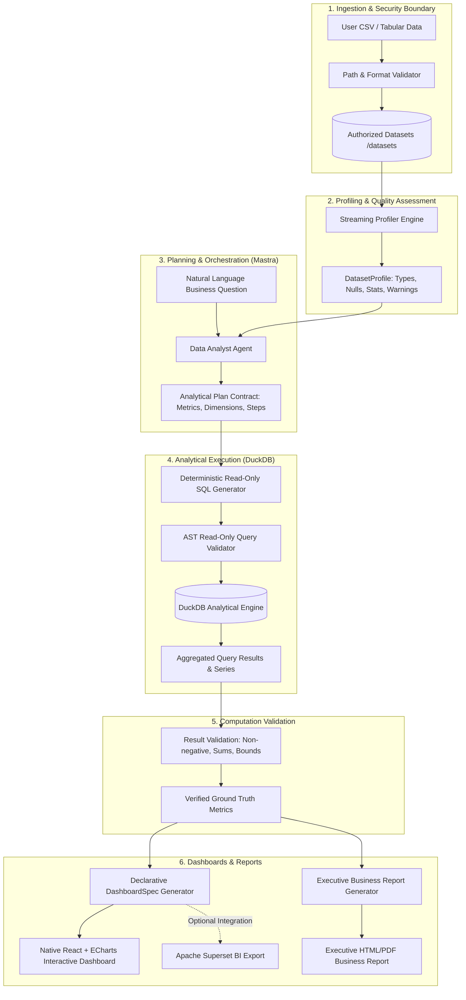

# Autonomous Data Analyst Architecture

## Overview
The Autonomous Data Analyst is an enterprise-grade AI analytics system built on top of the [Mastra](https://mastra.ai) framework. Its primary mission is to automate the core routine workflows of a 2–4 person business data analytics team: ingesting and profiling business data, planning analyses, executing safe SQL aggregations, validating calculations, rendering interactive dashboards (as an open-source Power BI alternative), and producing publication-ready executive business reports.

---

## End-to-End System Architecture

---

## Component Responsibilities

### 1. Ingestion & Security Layer (`src/lib/dataset/validator.ts`)
- Restricts filesystem access strictly to the configured `DATASETS_DIR` (default `./datasets`).
- Defends against path traversal (`..`), symlink redirection, unauthorized extensions, and oversized files (`MAX_DATASET_SIZE_MB`, default 50 MB).
- Sanitizes file references so server host directory paths are never exposed in user-facing logs or responses.

### 2. Dataset Profiling & Inspection Layer (`src/lib/dataset/profiler.ts`)
- Streams large files record-by-record using `csv-parse` and Node.js readable streams.
- Infers granular data types (`integer`, `float`, `boolean`, `date`, `datetime`, `string`).
- Computes exact summary statistics (min, max, mean, sample std-dev $s = \sqrt{\frac{1}{N-1}\sum (x_i - \bar{x})^2}$, median, p25, p75) with linear rank interpolation.
- Detects duplicate rows via rolling SHA-256 row hashes.
- Flags empirical data quality warnings (constant columns, high null percentage >50%, duplicate headers, inconsistent row counts).

### 3. Agent & Analytical Contracts Layer (`src/mastra/`)
- **Mastra Application Core (`src/mastra/index.ts`)**: Central registration point for all agents, tools, and workflows.
- **Data Analyst Agent (`src/mastra/agents/data-analyst-agent.ts`)**: Primary reasoning agent configured with analytical grounding invariants:
  - Must clarify ambiguous queries.
  - Distinguishes observed empirical facts from hypotheses.
  - Never invents numbers, query results, or dataset metadata.
  - Formulates structured analytical contracts before querying.
- **Tool Suite (`src/mastra/tools/`)**:
  - `profile-dataset-tool`: Generates structured `DatasetProfile`.
  - `inspect-dataset-tool`: Schema, column types, and quality summary.
  - `preview-dataset-tool`: Bounded record inspection (head/tail/sample, max 100 rows).
  - `formulate-plan-tool`: Structured breakdown of business questions into target metrics and query strategies.
  - `validate-result-tool`: Verification contract checking computed metrics against known constraints.

### 4. Analytical Execution Layer (`src/lib/analytics/` & `src/mastra/tools/execute-analytical-query-tool.ts`)
- High-performance, in-process analytical SQL execution over local CSV and Parquet datasets using DuckDB (v1.4.4).
- Materializes authorized datasets into in-memory tables and locks down the database with `SET enable_external_access = false;` to block all external filesystem access, socket connections, and extension installs.
- Enforces strict read-only AST validation (`node-sql-parser`) with single-statement guarantees, keyword blocklists, and table allowlists.
- Computes complete aggregates (COUNT, SUM, AVG, MIN, MAX, GROUP BY, date grouping) while applying bounded row limits to presentation.
- Enforces query execution timeouts (`QueryTimeoutError`) and safe resource cleanup with `db.close()`.
- Captures tamper-evident provenance metadata (`datasetFile`, `executedSql`, `executionTimeMs`, `rowLimitApplied`, `isTruncated`, `engine`).

### 5. Automated EDA & Evidence-Backed Insights Engine (`src/lib/analytics/` & `src/mastra/tools/run-automated-eda-tool.ts`)
- End-to-end automated exploratory data analysis directly powered by DuckDB over 100% of the dataset:
  - Numeric distributions: exact mean, std dev, median, quartiles (p25, p75), IQR, skewness, and kurtosis.
  - Anomaly detection: IQR-based outlier thresholding ($[Q1 - 1.5 \times IQR, Q3 + 1.5 \times IQR]$) counting exact outlier occurrences.
  - Categorical analysis: cardinality ratios, mode identification, frequency breakdowns, and top-category concentration.
  - Temporal trend assessment: automated date detection, adaptive granularity (daily, weekly, monthly), trajectory direction (`increasing`, `decreasing`, `flat`, `volatile`), period growth rates, and $\pm 2\sigma$ anomaly detection.
  - Pairwise Pearson correlation matrix with strict anti-causation safeguards and constant-column exclusion.
  - Data hygiene auditing: missingness rates, completeness scores, constant column detection, and small sample size warnings.
- Structured insight generation (`generateBusinessInsights`):
  - Strict epistemic separation: `observedFact` (empirical computed reality) vs `hypothesis` (conjecture/driver) vs `recommendation` (actionable guidance).
  - Priority ranking (`critical`, `high`, `medium`, `low`) based on business urgency and impact.
  - Every insight links directly to `supportingMetrics` and `analyticalMethod` without statistical fabrication.
  - Exposed via Mastra tool `runAutomatedEdaTool` and CLI runner (`npm run eda`).

### 6. Native Dashboard & Visualization Engine (Milestone 6)
- Free, open-source alternative to Power BI built directly into the application:
  - Generates declarative, strongly-typed JSON dashboard specifications ([`DashboardSpec`](file:///d:/autonomous-data-analyst/src/lib/dashboard/types.ts)) versioned under `1.0.0`.
  - Executive KPI cards with trend indicators, growth badges, and DuckDB evidence provenance tags.
  - Adaptive visualizations:
    - Categorical rankings and compositions (horizontal/vertical bar charts and donut charts).
    - Time-series trajectories with $\pm 2\sigma$ anomaly spike markers and period growth badges.
    - Statistical distributions and IQR outlier boundaries (histograms).
    - Bivariate relationships (scatter plots) and pairwise Pearson correlation matrix with mandatory non-causation warnings.
  - Interactive slicers: discrete category and status dropdowns for real-time table filtering.
  - Data records table with multi-column sorting, live text search, and client pagination, explicitly distinguishing displayed rows from complete-dataset aggregates.
  - Strategic business insights cards preserving the separation of observed facts from hypotheses and recommendations.
  - Strict security guardrails: maximum 16 charts, 8 KPIs, 5,000 data points per chart, 1,000 table rows, and zero executable code executed in the browser.
- Frontend architecture:
  - Built with Vite, React 19, TypeScript, and Apache ECharts (`echarts`).
  - Completely decoupled from backend agent secrets and server processes.
  - Production bundle generated via `npm run build:dashboard` into `dist/client/`.
  - Local live preview accessible via `npm run dev:dashboard` on `http://localhost:5173/`.

### 7. Executive Report Generation Engine (Milestone 7)
- Automatically composes structured, publication-ready executive business reports (`ReportSpec`) versioned under `1.0.0`:
  1. Cover Page & Scope Metadata (Title, dataset provenance, record count, scope, reporting period, data trust rating).
  2. Executive Summary (Headline finding, primary takeaways, business implications, trust scorecard).
  3. Executive KPI Scorecard (Formatted values, units, definitions, trend indicators, comparison periods where established).
  4. Data Quality & Completeness Assessment (Overall completeness score, column-level scorecard, null percentages, statistical flags).
  5. Ranked Strategic Findings & Recommendations (Strict epistemic separation of **Observed Fact (Evidence-Backed)**, **Exploratory Hypothesis**, and **Recommended Action**).
  6. Analytical Visualizations (Inline vector SVG charts for distribution and temporal trends, rendering crisply in print without network calls).
  7. Detailed Tabular Summaries (Numeric and categorical distributions with explicit column alignment).
  8. Statistical Analysis (Pairwise Pearson correlations, sample sizes, Tukey IQR outlier attributes, and prominent non-causation warning notice).
  9. Methodology, Stated Assumptions, Limitations, and Data Provenance.
  10. Statistical Appendix (IQR outlier rule, Pearson correlation scale, completeness score definitions).
- Formatted as responsive, accessible HTML with print stylesheets (`@media print`, `@page`, page breaks).
- High-fidelity PDF export via lightweight `puppeteer-core` with automatic system browser discovery (Chrome/Edge/Chromium).
- Registered via Mastra tool `generateReportTool` and terminal CLI runner `npm run report`.

### 8. Sandboxed Python Analytics Engine (Milestone 8)
- Dedicated, process-isolated Python statistical execution environment (`src/lib/python/`):
  - Extends DuckDB aggregation and EDA capabilities with deep statistical methods:
    1. Descriptive distribution moments (skewness, excess kurtosis, standard error, 95% confidence intervals, and Tukey 1.5x IQR outliers).
    2. Group comparisons & hypothesis testing (two-sample Welch's t-test for unequal variances, non-parametric Mann-Whitney U rank test, and Cohen's d effect size).
    3. Ordinary Least Squares (OLS) linear regression modeling (slope, intercept, R², adjusted R², Pearson correlation, standard error of slope, and p-values).
    4. Multi-group variance testing via One-Way ANOVA F-tests.
    5. Categorical independence testing via Chi-Square contingency table analysis with Cochran minimum cell frequency checks.
    6. Time-series trend decomposition and rolling moving averages with strict observation thresholds ($n \ge 15$).
  - Multi-tier defense-in-depth isolation boundary:
    - Worker runs in a separate process (`worker_runner.py`) with zero Node.js memory sharing.
    - AST / static code safety inspector rejecting forbidden syscalls, OS modules, network exfiltration, arbitrary file access, and dynamic code evaluation (`os.system`, `subprocess`, `socket`, `urllib`, `requests`, `eval`, `exec`).
    - Environment sanitization: scrubbed process environment strictly stripping all application secrets (`OPENAI_API_KEY`, etc.).
    - Ephemeral scratchpad directory (`reports/tmp/py_sandbox_<uuid>`) with automated cleanup.
    - Dataset path traversal containment enforcing authorized roots (`datasets/`, `data/`, `reports/`).
    - Execution bounds: default 10s timeout (configurable max 30s) and 512 KB buffer limits.
    - Lazy package loading for sub-10ms startup times on standard library math/statistics tasks.
  - Refined insight generation: distinguishes descriptive operational status baselines (e.g. `payment_status = Completed`, `discount_applied = false`) from strategic commercial findings.
  - Registered via Mastra tool `runPythonAnalysisTool` and CLI runner `npm run python:analyze`.

### 9. Business Context, Semantic Layer & Grounded Domain RAG (Milestone 9)
- Declarative semantic layer (`src/lib/semantic/`):
  - Authoritative metric repository conforming to accounting standards (ASC 606).
  - Multi-level tenant scoping (`application_wide`, `organization`, `dataset_specific`).
  - Untrusted text sanitization removing prompt injection control blocks.
  - Deterministic metric resolver (`BusinessMetricResolver`) preventing hallucinated columns or metric definitions, detecting ambiguity with actionable clarifying questions, and enforcing metric additivity.
  - Registered via Mastra tools `resolveBusinessMetricTool` and `queryBusinessContextTool`.

### 10. Workflow Orchestration, Evaluations, and Observability (Milestone 10)
- End-to-end typed workflow orchestrator (`AnalyticalWorkflowOrchestrator`):
  - 8 explicit stages: Inspection → Semantic Resolution → Planning → Execution (DuckDB/Python) → Evidence Validation → Insight Generation → Artifact Generation → Response Assembly.
  - Typed stage transitions with granular statuses (`completed`, `ambiguity_clarification_needed`, `incompatible_schema`, `unresolved_exploratory`, `validation_failed`, `partial_success_artifact_failed`, `execution_error`, `terminal_failure`).
  - Non-destructive partial failure handling preserving verified analytical evidence when artifact export encounters errors.
  - Native Mastra workflow integration via `analyticalWorkflow` (`src/mastra/workflows/analytical-workflow.ts`).
- Observability & Correlated Execution Tracing (`WorkflowTracer`):
  - Correlated `traceId` and `runId` tracking stage durations, tool invocations, retry counts, and failure categories.
  - SHA-256 deterministic schema fingerprinting.
  - Privacy-preserving redaction (`redactSensitiveData`) automatically stripping API keys, Bearer tokens, DB passwords, email addresses, and raw data dumps.
- Deterministic Evaluation & Benchmarking Suite (`src/lib/eval/`):
  - 12 reproducible benchmark fixtures testing numerical accuracy, disambiguation, schema non-hallucination, Student-t rigor, anti-causation restraint, prompt-injection defense, and failure recovery.
  - Persisted JSON reports (`reports/eval-summary.json`) tracking numerical correctness, evidence coverage, and task completion rates.
  - CLI commands: `npm run eval` and `npm run workflow:analyze`.

### 11. Production Application, Secure Persistence, and Live Workflow Integration (Milestone 11)
- Multi-tenant enterprise foundation connecting React frontend to the analytical engine:
  - **Relational PostgreSQL Persistence**:
    - Complete relational schema for `organizations`, `users`, `memberships`, `sessions`, `datasets`, `dataset_profiles`, `analyses`, and `artifacts`.
    - Versioned DDL migrations (`migrations/0001_initial_schema.sql`) executed via `npm run migrate`.
    - Typed database abstraction (`DatabaseAdapter`) with `PostgresAdapter` for production and zero-dependency `MemoryDbAdapter` for isolated integration testing.
  - **Authentication & RBAC**:
    - Secure sessions using cryptographically random 256-bit tokens hashed with SHA-256 in the database.
    - Password hashing using `crypto.scryptSync` with unique 16-byte salts and constant-time `crypto.timingSafeEqual` verification.
    - Explicit role-based permissions (`admin`, `analyst`, `viewer`) defending every endpoint.
    - Tenant isolation: strict verification of dataset, analysis, trace, and artifact ownership preventing Insecure Direct Object Reference (IDOR) attacks.
  - **Tenant Dataset Storage**:
    - Server-controlled paths (`datasets/tenants/<orgId>/<datasetId>.<ext>`) preventing path traversal and directory leakage.
    - Multi-tenant dataset isolation: analytical queries are restricted to authorized tenant storage paths.
    - Automated cleanup of partial and failed uploads.
  - **Background Worker Queue (BullMQ / Redis)**:
    - Decouples long-running analytics from HTTP request lifecycles via `AnalysisQueueAdapter`.
    - Production `BullMqAnalysisQueue` for distributed Redis clusters and `InMemoryAnalysisQueue` fallback.
    - Stage progress reporting (0% to 100%), bounded exponential-backoff retries for transient errors, and permanent-failure classification.
    - Client-initiated cancellation supported via `AbortSignal`.
  - **Production Python Isolation (Fail-Closed)**:
    - Verifies container isolation via physical environment probes (`/.dockerenv`, `/run/.containerenv`, or `/proc/1/cgroup`).
    - Config flag `CONTAINER_SANDBOX_ACTIVE=true` alone is strictly insufficient; fails closed with `PythonSandboxSecurityError` when container isolation is unverified in production.
    - Preserves parameter-driven statistical routines (descriptive stats, t-tests, ANOVA, linear regression) within verified boundary.
  - **REST API & Live Frontend**:
    - Express REST API (`src/server/index.ts`) providing `/api/auth`, `/api/datasets`, `/api/analyses`, `/api/artifacts`, and `/api/health`.
    - Vite proxy connecting the React frontend with full interactive dataset upload, profiling, live question submission with progress tracking, disambiguation prompt handling, and authorized artifact download.

### 12. BI Integrations & Scheduled Autonomous Analysis (Milestone 12)
- **Database-Backed Durable Scheduler (`src/lib/scheduler/daemon.ts`, `src/lib/scheduler/service.ts`)**:
  - Background polling daemon running on configurable intervals (`SCHEDULER_POLL_INTERVAL_MS`).
  - Strict idempotent dispatch using atomic locks and deterministic keys (`schedule:<id>:<scheduledFor>`).
  - Active concurrency limits per schedule to prevent overlapping executions.
  - Restart recovery and missed run reconciliation on daemon boot.
- **Timezone & Daylight-Saving Correctness (`src/lib/scheduler/timezone.ts`)**:
  - Fully timezone-aware 5-field cron parsing using IANA identifiers (e.g. `America/New_York`, `UTC`, `Europe/London`).
  - Handles DST spring forward (skips invalid local hour safely to next valid occurrence) and fall back (disambiguates repeated hour deterministically).
- **Scheduled Report Delivery (`src/lib/delivery/service.ts`)**:
  - Scoped to authenticated organizations with anti-IDOR boundaries.
  - Webhooks authenticated via HMAC-SHA256 (`X-ADA-Signature`, `X-ADA-Timestamp`, `X-ADA-Delivery-Id`).
  - Recipient email address validation.
  - All destination secrets (tokens, signing keys) are encrypted via AES-256-GCM and never leaked in API payloads or execution logs.
- **Apache Superset BI Platform Integration (`src/lib/bi/superset-client.ts`, `src/lib/bi/service.ts`)**:
  - Live API connector supporting JWT login/refresh, dataset discovery, chart publishing, and latency measurement.
  - Typed error hierarchy (`BiAuthenticationError`, `BiPermissionError`, `BiRateLimitError`, `BiConnectionError`).
  - Credential rotation and in-memory token invalidation.

---

## Security & Reliability Boundaries

| Boundary | Control Mechanism | Status |
|---|---|---|
| **API Keys & Secrets** | Stored in `.env` (gitignored). Validated via Zod; never printed in logs or errors. Scrubbed from Python worker subprocess. Redacted from observability traces. | Active |
| **Model Invocations** | Supported model whitelist (`openai/gpt-4o`, `openai/gpt-4o-mini`). No silent fallbacks. | Active |
| **Filesystem Access** | Path traversal defense via `path.resolve` + `fs.realpathSync`. Access constrained to `DATASETS_DIR`. Absolute server paths never leaked. | Active (Milestones 2 & 7) |
| **File Formats & Size** | Supports `.csv` and `.parquet`. Capped by configurable `MAX_DATASET_SIZE_MB` (default 50 MB). Empty files rejected. | Active (Milestones 2 & 4) |
| **Code Execution** | Core backend uses zero `eval` or dynamic shell execution. Python analytics executes inside an isolated subprocess with AST validation. | Active (Milestone 8) |
| **Analytical SQL Sandbox** | Double-layer defense: AST parser restricts to single-statement read-only SELECT + CTEs on authorized aliases; DuckDB engine locks down external access (`SET enable_external_access = false`). Query timeouts and bounded row serialization. | Active (Milestone 4) |
| **PDF Generation Sandbox** | Headless browser execution locked to local HTML rendering without network access or disk writes beyond authorized report directories. | Active (Milestone 7) |
| **HTML/Script Sanitization** | Strict HTML escaping on all report fields, dataset labels, and dynamic strings to prevent injection. | Active (Milestone 7) |
| **Python Analytics Isolation** | Process isolation, environment secret scrubbing, AST code validator, ephemeral scratchpad, path traversal containment, and wall-clock timeouts. | Active (Milestone 8) |
| **Prompt-Injection Defense** | Excises LLM chat delimiters (`<|im_start|>`) and neutralizes instruction hijacking phrases in retrieved business context documents. | Active (Milestone 9) |
| **Ambiguity & Disambiguation** | Prevents blind guessing or running arbitrary queries when business terms (Gross vs Net Revenue) conflict; halts with actionable clarifying questions. | Active (Milestone 9 & 10) |
| **Partial Failure Isolation** | Failures in artifact generation (PDF/Dashboard) are isolated; validated analytical calculations and insights are strictly preserved. | Active (Milestone 10) |
| **Trace Privacy & Redaction** | `redactSensitiveData` scrubs credentials, bearer tokens, connection passwords, emails, and large row arrays before trace persistence. | Active (Milestone 10) |
| **Tenant Isolation & IDOR** | Cryptographic session tokens, scrypt password hashing, RBAC enforcement (`admin`, `analyst`, `viewer`), server-controlled tenant storage paths, and cross-tenant reference verification. | Active (Milestone 11) |
| **Database & Job Durability** | Relational PostgreSQL schema with foreign keys, indexes, and versioned migrations. Decoupled BullMQ background jobs with progress and abort signals. | Active (Milestone 11) |
| **Python Prod Fail-Closed** | Requires physical container verification (`/.dockerenv`, `/run/.containerenv`). Fails closed against arbitrary scripts in production if unverified. | Active (Milestone 11) |
| **Scheduler Concurrency & Idempotency** | Atomic dispatch lock, deterministic idempotency keys, overlapping run suppression, and missed run recovery on boot. | Active (Milestone 12) |
| **Destination Credential Encryption** | AES-256-GCM encryption for webhook secrets and BI credentials at rest; decrypted strictly in memory for dispatch; masked in API responses. | Active (Milestone 12) |
| **HMAC Webhook Authentication** | Outgoing webhook signatures calculated with SHA-256 HMAC and verified against replay attacks using timestamps and delivery IDs. | Active (Milestone 12) |
| **BI Integration Boundary** | Strict typed error handling, JWT credential rotation, and zero credential leakage in audit logs or network responses. | Active (Milestone 12) |
| **Output Integrity** | Strict system instructions requiring verification and disallowing hallucinated rows, causes, or findings. | Active |

---

## Architecture Decision Records
- [ADR 0001: Mastra as Primary Agent Orchestration Framework](decisions/0001-mastra-as-primary-agent-framework.md)
- [ADR 0002: Streaming Dataset Profiling Engine with Memory and Security Boundaries](decisions/0002-streaming-dataset-profiling-engine.md)
- [ADR 0003: Dashboard and Business Reporting Architecture Strategy](decisions/0003-dashboard-and-reporting-strategy.md)
- [ADR 0004: In-Memory DuckDB Analytical Execution Engine and AST Sandboxing](decisions/0004-duckdb-analytical-execution-and-sandboxing.md)
- [ADR 0005: Automated EDA Engine and Evidence-Backed Business Insights](decisions/0005-automated-eda-and-evidence-backed-insights.md)
- [ADR 0006: Declarative Dashboard Specification and Deterministic React/ECharts Renderer](decisions/0006-declarative-dashboard-spec-and-echarts-renderer.md)
- [ADR 0007: Executive Business Report Generation with Semantic HTML & Headless PDF Export](decisions/0007-executive-report-generation-and-pdf-export.md)
- [ADR 0008: Sandboxed Python Analytics Engine & Isolation Boundaries](decisions/0008-sandboxed-python-analytics.md)
- [ADR 0009: Business Context, Semantic Layer & Grounded Domain RAG](decisions/0009-business-context-and-semantic-layer.md)
- [ADR 0010: Workflow Orchestration, Evaluations, and Observability](decisions/0010-workflow-orchestration-evaluations-and-observability.md)
- [ADR 0011: Production Application, Secure Persistence, and Live Workflow Integration](decisions/0011-production-application-secure-persistence-and-live-workflow.md)
- [ADR 0012: BI Integrations and Scheduled Autonomous Analysis](decisions/0012-bi-integrations-and-scheduled-analytics.md)
