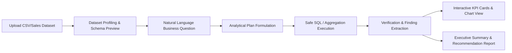

# Autonomous Data Analyst — Product Vision & Revised Roadmap

## 1. Product Vision
The Autonomous Data Analyst is an enterprise-grade AI analytics system designed to automate substantial portions of routine work performed by a 2–4 person business data analytics team. 

Instead of a generic chatbot that merely answers text questions, the system functions as a trustworthy, end-to-end analytical partner:
1. **Ingests & Profiles**: Inspects raw business data (CSV, Excel, databases), understands schemas, and flags data-quality issues.
2. **Formulates Plans & Queries**: Deconstructs natural language business inquiries (e.g. *"Why did Q3 revenue drop 12% in the Western region?"*) into verifiable analytical plans and executes safe analytical SQL or calculations.
3. **Validates & Grounds**: Mathematically cross-checks results, separates empirical facts from hypotheses, and never hallucinates numbers or conclusions.
4. **Delivers Interactive Dashboards**: Generates interactive, Power-BI-grade dashboard views (KPI cards, bar/line/scatter/funnel charts, tables, slicers).
5. **Produces Business Reports**: Automatically generates publication-ready executive business reports complete with an executive summary, methodology, key findings, supporting visual evidence, recommendations, and quality warnings, with one-click export (PDF/HTML).

---

## 2. End-to-End Vertical Slice (The First Complete Loop)
To avoid building disjointed components, we define the **Smallest End-to-End Vertical Slice** that demonstrates complete business value before scaling to enterprise features:



This vertical slice connects **Milestones 1 through 7**:
- User provides a business sales dataset.
- System identifies columns, datatypes, and data cleanliness.
- User asks a business performance question.
- System creates a plan, queries the data deterministically, verifies the math, emits an interactive dashboard spec, and compiles an executive report with actionable recommendations.

---

## 3. Revised 12-Milestone Roadmap

### Milestone 1 — Agent Foundation (Completed)
- Established strict TypeScript and ESM architecture.
- Integrated official `@mastra/core` and `Mastra` application instance.
- Configured `dataAnalystAgent` with analytical grounding principles and secret protections.
- Established Vitest test suite and build pipeline.

### Milestone 2 — Safe Dataset Profiling (Completed)
- Built streaming CSV profiler engine using `csv-parse` and Node.js streams.
- Implemented robust type inference (`integer`, `float`, `boolean`, `date`, `datetime`, `string`).
- Calculated exact numeric statistics (min, max, mean, sample std-dev, median, p25, p75) and null/distinct rates.
- Added duplicate-row detection via rolling SHA-256 hashes and quality warnings.
- Enforced filesystem path traversal sandboxing and file size constraints.
- Integrated `profileDatasetTool` with `dataAnalystAgent` and CLI runner (`npm run profile`).

### Milestone 3 — Dataset Interaction & Analytical Contracts (Completed)
- Formalized dataset interaction tools with clear separation of concerns:
  - `inspect_dataset`: Lightweight column metadata, inferred types, null rates, and quality warnings with canonical profile caching.
  - `preview_dataset`: Safe windowed record preview (head/tail/sample modes) with strict row limits (1–100) and column projection.
  - `formulate_analysis_plan`: Structured analytical contract breaking down a question into metrics, formulas, required columns, filters, grouping dimensions, explicit assumptions, and unresolved ambiguities.
  - `validate_analysis_result`: Domain-aware result validation against explicit metric semantics (non-negativity with context, percentage bounds, range tolerances, reconciliation sums, and business assertions) returning `valid`, `invalid`, or `unverifiable`.
- Registered all tools on `dataAnalystAgent` and the `Mastra` application instance.

### Milestone 4 — Reliable Analytical Execution (Completed)
- Embedded in-process, high-performance analytical SQL engine (**DuckDB** v1.4.4) with zero external database dependencies.
- Implemented double-layer security sandboxing:
  - Materialized dataset into RAM table and applied `SET enable_external_access = false;` to block all external filesystem and network access.
  - AST-based read-only SQL validation (`node-sql-parser`) enforcing single-statement execution, rejecting mutations (`INSERT`, `UPDATE`, `DELETE`, `DROP`), blocking unauthorized functions (`read_csv`, `read_parquet`, `install`, `load`), and restricting table references strictly to the authorized dataset alias and CTEs.
- Supported both CSV and Parquet formats natively with automatic null-string recognition and BigInt JSON serialization.
- Maintained aggregate completeness across full datasets while applying bounded row limits to result presentation.
- Implemented query execution timeouts with `db.interrupt()` and safe resource cleanup.
- Integrated `executeAnalyticalQueryTool` with `dataAnalystAgent` and added CLI demonstration (`npm run query`).

### Milestone 5 — Exploratory Data Analysis & Automated Insights (Completed)
- In-memory automated exploratory data analysis directly powered by DuckDB across 100% of authorized datasets:
  - Numeric distributions: mean, median, sample std dev, quartiles (p25, p75), IQR, skewness, and kurtosis.
  - IQR-based outlier thresholding with exact counts and outlier percentages.
  - Categorical cardinality metrics, top value breakdowns, and mode concentration percentages.
  - Temporal trend assessment: adaptive granularity, growth rates, trajectory direction, and $\pm 2\sigma$ period anomaly detection.
  - Pairwise Pearson correlation matrix with strict anti-causation safeguards and constant-column exclusion.
  - Complete data quality audits: missingness rates, completeness scores, constant column detection, and small sample size warnings.
- Structured business insight generation (`generateBusinessInsights`):
  - Strict epistemic separation: `observedFact` vs `hypothesis` vs `recommendation`.
  - Priority ranking (`critical`, `high`, `medium`, `low`) based on business impact and urgency.
  - Mandatory anti-causation safeguards and experimental next-step recommendations for correlation findings.
  - Zero hallucination: every metric links directly to computed EDA results in `supportingMetrics`.
- Versioned contract (`1.0.0`) under `EdaAndInsightsResultSchema` ready for Milestone 6 dashboards and Milestone 7 reports.
- Mastra tool `runAutomatedEdaTool` registered on `dataAnalystAgent` and `mastra`.
- Terminal CLI runner available via `npm run eda`.

### Milestone 6 — Interactive Dashboard Generation (Completed)
- Native Power BI alternative architecture:
  - Declarative, strongly-typed JSON dashboard specification ([`DashboardSpec`](file:///d:/autonomous-data-analyst/src/lib/dashboard/types.ts)) versioned under `1.0.0`.
  - Executive KPI cards with trend indicators, growth badges, and DuckDB evidence provenance tags.
  - Adaptive visualizations:
    - Categorical rankings and compositions (horizontal/vertical bar charts and donut charts).
    - Time-series trajectories with $\pm 2\sigma$ anomaly spike markers and period growth badges.
    - Statistical distributions and IQR outlier boundaries (histograms).
    - Bivariate relationships (scatter plots) and pairwise Pearson correlation matrix with mandatory non-causation warnings.
  - Interactive slicers: discrete category and status dropdowns for real-time table filtering.
  - Data records table with multi-column sorting, live text search, and client pagination, explicitly distinguishing displayed rows from complete-dataset aggregates.
  - Strategic business insights cards preserving the separation of observed facts from hypotheses and recommendations.
  - Strict security guardrails: maximum 16 charts, 8 KPIs, 5,000 data points per chart, 1,000 table rows, and zero executable code executed in the browser.
  - Frontend decoupled from backend agent secrets: Vite + React 19 + Apache ECharts (`echarts`).
  - Mastra tool `generateDashboardSpecTool` registered on `dataAnalystAgent` and `mastra`.
  - CLI runner `npm run dashboard:demo` and dev server `npm run dev:dashboard`.

### Milestone 7 — Business Report Generation (Completed)
- Production-grade executive business report generation:
  - Versioned declarative schema contract ([`ReportSpec`](file:///d:/autonomous-data-analyst/src/lib/report/types.ts)) under `1.0.0` with strict Zod validation.
  - Comprehensive executive report structure:
    - Cover & metadata: Title, subtitle, dataset provenance, record count, scope, reporting period, data trust rating.
    - Executive summary: Headline takeaways, business implications, data trust rating.
    - KPI scorecards: Formatted metrics with units, definitions, trend indicators, and evidence provenance.
    - Data quality assessment: Overall score, column completeness scorecard, null rates, and statistical flags.
    - Strategic findings: Ranked by importance with strict epistemic separation of **Observed Fact (Evidence-Backed)**, **Exploratory Hypothesis**, and **Recommended Action**.
    - Print-ready analytical visualizations: Crisp vector SVG charts (distribution bars, temporal trends) that render instantaneously in PDF without external CDN dependencies.
    - Structured tabular results: Multi-column summaries for numeric and categorical distributions.
    - Statistical distribution & association analysis: Pairwise Pearson correlations with sample sizes, Tukey 1.5x IQR outliers, and mandatory non-causation warning notice.
    - Methodology, assumptions, limitations, and data provenance documentation.
    - Statistical appendix: Technical definitions and mathematical formulas for IQR, Pearson r, and completeness scores.
  - High-fidelity PDF export via lightweight `puppeteer-core` with system browser auto-detection (Chrome/Edge/Chromium) and zero heavy bundle downloads.
  - Mastra tool `generateReportTool` registered on `dataAnalystAgent` and `mastra`.
  - Terminal CLI demonstration available via `npm run report`.

### Milestone 8 — Sandboxed Python Analytics (Completed)
- Isolated Python statistical execution service:
  - Versioned contract ([`PythonAnalysisRequestSchema`](file:///d:/autonomous-data-analyst/src/lib/python/types.ts) and [`PythonAnalysisResultSchema`](file:///d:/autonomous-data-analyst/src/lib/python/types.ts)) under `1.0.0` with strict Zod validation.
  - Multi-tier defense-in-depth isolation boundary:
    - Dedicated worker subprocess (`src/lib/python/worker_runner.py`) with zero Node.js memory sharing.
    - AST / static code safety inspector rejecting forbidden syscalls, OS modules, network exfiltration, arbitrary file access, and dynamic code evaluation (`os.system`, `subprocess`, `socket`, `urllib`, `requests`, `eval`, `exec`).
    - Environment sanitization: explicitly scrubbed environment strictly stripping all application secrets (`OPENAI_API_KEY`, etc.).
    - Ephemeral scratchpad (`reports/tmp/py_sandbox_<uuid>`) with automated cleanup.
    - Dataset path traversal containment enforcing authorized roots (`datasets/`, `data/`, `reports/`).
    - Execution bounds: default 10s timeout (configurable max 30s) and 512 KB buffer limits.
    - Lazy package loading for sub-10ms startup times on standard library math/statistics tasks.
  - Six core analytical tasks supported:
    - Descriptive distribution moments (mean, median, variance, std dev, skewness, excess kurtosis, standard error, 95% confidence intervals, Tukey 1.5x IQR outliers).
    - Group comparisons & hypothesis testing (two-sample Welch's t-test for unequal variances, Mann-Whitney U test, Cohen's d effect size).
    - Ordinary Least Squares (OLS) linear regression modeling (slope, intercept, R², adjusted R², Pearson r, standard error of slope, and p-values).
    - Multi-group comparisons via One-Way ANOVA F-tests with between/within group variance breakdowns.
    - Categorical independence testing via Chi-Square contingency table analysis with Cochran cell frequency checks.
    - Time-series decomposition and moving averages with strict minimum observation constraints ($n \ge 15$).
  - Refined insight generation: descriptive operational status baselines (e.g. `payment_status = Completed`, `discount_applied = false`) categorized as descriptive facts rather than false strategic concentration findings.
  - Mastra tool `runPythonAnalysisTool` registered on `dataAnalystAgent` and `mastra`.
  - Terminal CLI demonstration available via `npm run python:analyze`.

### Milestone 9 — Business Context, Semantic Layer & Grounded Domain RAG (Completed)
- Versioned corporate semantic layer and metric repository:
  - Declarative contracts ([`BusinessMetricDefinitionSchema`](file:///d:/autonomous-data-analyst/src/lib/semantic/types.ts), [`BusinessGlossaryTermSchema`](file:///d:/autonomous-data-analyst/src/lib/semantic/types.ts), [`BusinessContextDocumentSchema`](file:///d:/autonomous-data-analyst/src/lib/semantic/types.ts), [`MetricResolutionResultSchema`](file:///d:/autonomous-data-analyst/src/lib/semantic/types.ts)) under `1.0.0` with strict Zod validation.
  - Pre-seeded commerce & retail metrics conforming to accounting standards (ASC 606): Gross Revenue, Net Revenue, Average Order Value (AOV), Units Per Transaction (UPT), and Discount Penetration Rate.
  - Multi-level tenant boundary isolation (`application_wide`, `organization`, `dataset_specific`) enforced across metrics and context documents via `isScopeAccessible()`.
  - Untrusted text sanitization defense: strips LLM chat control tokens (`<|im_start|>`, `<|system|>`) and neutralizes prompt-injection instruction hijacking phrases.
  - Grounded metric resolver (`BusinessMetricResolver`):
    - Validates required source columns and compatible data types against profiled dataset schema.
    - Resolves natural-language business questions to exact SQL expressions.
    - Enforces metric additivity classifications (`additive`, `semi_additive`, `non_additive`) preventing summing ratios or averages across categories.
    - Detects ambiguity (e.g. Gross vs Net Revenue) and generates explicit clarifying questions without guessing.
    - Flags unapproved concepts as exploratory with mandatory warnings against presenting them as certified KPIs.
  - Mastra tools `resolveBusinessMetricTool` and `queryBusinessContextTool` registered on `dataAnalystAgent` and `mastra`.
  - Terminal CLI demonstration available via `npm run semantic:query`.

### Milestone 10 — Workflows, Evaluations, and Observability (Completed)
- Versioned, typed Mastra Workflow (`analyticalWorkflow`) orchestrating the end-to-end analytical pipeline:
  - 8 explicit stages: Schema Inspection → Semantic Metric Resolution → Analytical Planning → Execution (DuckDB / Python Sandbox) → Evidence Validation → Insight Generation → Artifact Export (Dashboard / PDF) → Response Assembly.
  - Granular status discrimination: `completed`, `ambiguity_clarification_needed`, `incompatible_schema`, `unresolved_exploratory`, `validation_failed`, `partial_success_artifact_failed`, `execution_error`, and `terminal_failure`.
  - Non-destructive partial failure handling: artifact generation failures never erase or hallucinate over validated analytical evidence.
  - Bounded retries for transient execution failures (default max 2 retries) with strict timeout boundaries.
- Observability and Correlated Execution Tracing:
  - `WorkflowTracer` assigning correlated `traceId` (`trc_<uuid>`) and `runId` (`run_<uuid>`).
  - Stage-by-stage timing spans, retry tracking, failure categories, and SHA-256 deterministic schema fingerprinting.
  - Privacy-preserving redaction (`redactSensitiveData`): strips OpenAI/Anthropic/GitHub API keys, Bearer tokens, database connection passwords, email addresses, and large raw data arrays.
- Automated Evaluation Framework:
  - Deterministic evaluation runner executing 12 benchmark fixtures covering numerical correctness, business metric disambiguation, unsupported schemas, small-sample Student-t rigor, evidence traceability, anti-causation restraint, prompt-injection defense, read-only SQL AST safety, missing values/outliers, and failure recovery.
  - Outputs machine-readable summary reports (`reports/eval-summary.json`) tracking numerical correctness (100%), evidence coverage (100%), metric resolution accuracy (100%), unsupported claim rate (0%), and task completion rate (100%).
  - CLI commands: `npm run eval` and `npm run workflow:analyze`.

### Milestone 11 — Production Application, Secure Persistence, and Live Workflow Integration (Completed)
- Full-stack web application connecting React/TypeScript/ECharts frontend to live backend REST endpoints.
- Secure authentication with `scrypt` password hashing, timing-safe verification, secure cookies, and CSRF protection.
- Multi-tenant organization and RBAC model (`Admin`, `Analyst`, `Viewer`) with strict tenant boundary assertions on every operation (`assertTenantScope`) preventing IDOR attacks.
- PostgreSQL database persistence for metadata, user memberships, dataset profiles, and analysis history (`migrations/0001_initial_schema.sql`).
- Isolated physical dataset storage (`datasets/tenants/<orgId>/<uuid>.<ext>`) with path traversal containment, file-size limits, format validation, and automated cleanup.
- Asynchronous background execution with BullMQ/Redis and in-memory fallback, live stage progress reporting, bounded retries on transient errors, and cancellation support via `AbortController`.
- Python isolation fail-closed boundary: strictly fails closed in production and multi-tenant mode for arbitrary code unless verifiable container runtime indicators exist.
- Truthful dashboard slicers explicitly scoped to displayed data table records.
- Executive HTML and PDF artifact delivery with authorized download endpoints.
- 40 automated test suites with 236 passing tests.

### Milestone 12 — Enterprise BI Platform Integrations & Scheduled Analytics (Next Milestone)
- External BI platform export (Apache Superset, Metabase, Power BI push datasets).
- Scheduled recurrent analytical execution and automated reporting digests (Email/Slack/Webhooks).
- Advanced team collaboration, annotation threads, and governed metric approvals.

### Milestone 12 — Enterprise BI Integrations & Scheduled Analysis
- Optional export of generated datasets and dashboard slices to Apache Superset or Metabase for existing enterprise BI deployments.
- Scheduled recurring reports (e.g. weekly KPI emails or Slack digests).
- Direct connectors to cloud data warehouses (Snowflake, BigQuery, PostgreSQL).

---

## 4. Milestone 3 Detailed Specification

### Objective
Establish the foundational **dataset interaction tools** and **analytical contracts** that enable the agent to inspect table schemas, safely preview subsets of records, structure natural-language business questions into actionable analytical plans, and validate analytical findings against computational ground truth.

### Tool Responsibilities & Interfaces

1. `inspect_dataset`
   - **Responsibility**: Provides detailed metadata, column list, inferred data types, null rates, and quality flags for a specified dataset without re-profiling if cached.
   - **Input Schema**:
     ```typescript
     {
       filePath: z.string().min(1)
     }
     ```
   - **Output Schema**: Returns column definitions, inferred types, distinct counts, and active quality warnings.

2. `preview_dataset`
   - **Responsibility**: Retrieves a bounded sample of records from a dataset (head, tail, or random sample) with explicit row caps (default: 10, max: 100) and optional column projection.
   - **Input Schema**:
     ```typescript
     {
       filePath: z.string().min(1),
       mode: z.enum(['head', 'tail', 'sample']).default('head'),
       limit: z.number().int().min(1).max(100).default(10),
       columns: z.array(z.string()).optional()
     }
     ```
   - **Output Schema**: Returns row objects, total available rows, and selected column names. Prevents memory bloat by strictly limiting preview size.

3. `formulate_analysis_plan`
   - **Responsibility**: Analytical contract tool that takes a user question and dataset schema, producing a structured, verified plan detailing the analytical objective, required metrics, target columns, filtering criteria, and validation checkpoints.
   - **Input Schema**:
     ```typescript
     {
       datasetPath: z.string().min(1),
       businessQuestion: z.string().min(3),
       primaryObjective: z.string().min(3),
       targetMetrics: z.array(z.object({
         name: z.string(),
         description: z.string(),
         formula: z.string().optional()
       })),
       requiredColumns: z.array(z.string()),
       filters: z.array(z.string()).optional(),
       plannedSteps: z.array(z.string())
     }
     ```

4. `validate_analysis_result`
   - **Responsibility**: Verification contract tool that checks computed metric values against claimed assertions, ensuring metrics do not contradict known dataset constraints (e.g. negative prices, percentages > 100%, null division).
   - **Input Schema**:
     ```typescript
     {
       metricName: z.string(),
       computedValue: z.union([z.number(), z.string()]),
       validationRule: z.enum([
         'non_negative',
         'percentage_range_0_100',
         'not_null',
         'within_bounds',
         'matches_sum'
       ]),
       ruleParameters: z.record(z.any()).optional()
     }
     ```

### Acceptance Criteria for Milestone 3
1. All four tools (`inspect_dataset`, `preview_dataset`, `formulate_analysis_plan`, `validate_analysis_result`) are implemented using Mastra's `createTool` API with strict Zod schemas.
2. Tools are registered on the `dataAnalystAgent` and in `src/mastra/index.ts`.
3. Preview tool strictly respects row bounds (max 100 rows) and handles quoted CSV fields, missing columns, and path traversal defenses.
4. Plan and validation tools enforce structured analytical discipline without hallucinating calculations.
5. 100% of automated unit and integration tests pass.
6. TypeScript `tsc --noEmit` compiles with 0 errors.
7. Mastra application builds cleanly (`npm run build`).
